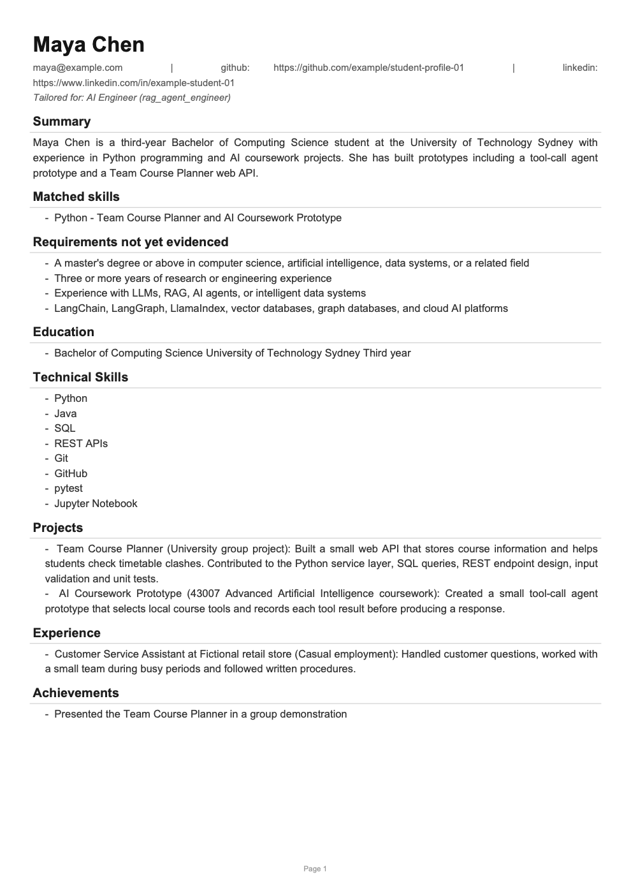
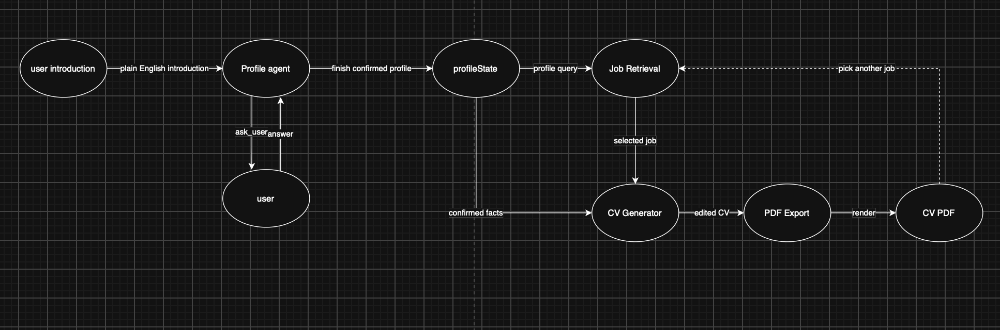

# AI-Powered CV Builder


An agentic GenAI application that turns a short, plain-English self-introduction into a **confirmed candidate profile**, retrieves the **most relevant jobs** with supporting evidence, and generates a **tailored, editable CV** that only uses facts the candidate actually confirmed. The final CV is exported as a polished PDF.

> Built for **UTS 43007 Advanced Artificial Intelligence** (Spring 2026), Assessment 1: *Your First GenAI System*.

<p align="center">
  
  <br><em>A CV generated for a synthetic student profile, tailored to an "AI Engineer (RAG / agents)" posting.<br>Note the separate "Requirements not yet evidenced" section: the system never invents skills to close the gap.</em>
</p>

---

## Table of contents

- [Why this project](#why-this-project)
- [How it works](#how-it-works)
- [Key design decisions](#key-design-decisions)
- [Evaluation](#evaluation)
- [Getting started](#getting-started)
- [Project structure](#project-structure)
- [Limitations](#limitations)
- [Development process](#development-process)

## Why this project

LLM-written CVs have one big failure mode: they **make the candidate look better than they are**. In early testing, a naive prompt ("make the candidate look as strong as possible") added skills such as *"AI Agents & Tool Calling"* and *"Prompt Design"* that appeared nowhere in the candidate's profile.

This project treats that as the core engineering problem. Every claim in the CV must be traceable to the confirmed profile, and requirements the candidate does not meet are listed openly instead of being papered over.

## How it works



1. **Intake** (`intake.py`): the LLM extracts *only* what the user explicitly stated in their introduction. No inference.
2. **Tool-calling agent** (`agent.py`): a multi-turn `ProfileAgent` inspects what is missing and decides its next action, up to 8 steps.

   | Tool | What it does |
   |---|---|
   | `ask_user(question)` | Asks one targeted follow-up question |
   | `update_profile(fields)` | Merges confirmed facts into the profile and returns what is still missing |
   | `retrieve_jobs(query, k)` | Searches the job index (top-k clamped to 3) |
   | `finish(reason)` | Ends the loop |

3. **Confirmed profile** (`profile.py`): a reusable `ProfileState`, stored separately from any job-specific CV content. One profile can drive many CVs, and users never share state.
4. **RAG job retrieval** (`retrieval.py`, `embeddings.py`): job postings are embedded locally with `sentence-transformers/all-MiniLM-L6-v2`, cached to disk and ranked by cosine similarity. Each result comes with a supporting excerpt from the posting.
5. **Grounded CV generation** (`cv_generator.py`): the LLM produces a summary, matched skills (each with profile evidence), missing requirements (each tied to a line of the job ad) and editable sections.
6. **Deterministic fact-check**: each matched skill's evidence is re-checked against the profile by token overlap (threshold 0.5). Unsupported claims are dropped.
7. **Editing and export** (`cli.py`, `pdf_export.py`): the user can edit any section in the CLI, then export an A4 PDF with `fpdf2`.

## Key design decisions

**Prompting alone is not trusted.** The CV prompt was revised from `CV_SYSTEM_V1` to `CV_SYSTEM_V2` (`prompts.py`):

| | V1 | V2 |
|---|---|---|
| Instruction | "Make the candidate look as strong as possible" | "You do not evaluate or embellish" + an explicit evidence boundary |
| Allowed evidence | Not restricted | Confirmed profile only (for claims), job description only (for requirements) |
| Output | Flat skills list, with invented skills and reworded experience | Fixed JSON schema: `profile_evidence` per matched skill, `job_line` per requirement |
| Same test input | Added 3 skills that are not in the profile | Claimed only *Python*, linked to two real projects; listed the degree and experience gaps separately |

On top of V2, the code-level fact-check acts as a safety net. Across the four sample CVs, `dropped_claims` was empty.

**Other choices**

- **System instructions are kept apart from user data.** Profile text is never interpolated into system prompts.
- **Free-tier friendly**: every LLM response is cached on disk, keyed by the full request, and transient `503` / timeout errors are retried with backoff.
- **Swappable embedding backend** behind a small `EmbeddingBackend` protocol, so tests can inject a deterministic fake.
- **Secrets stay out of source**: the API key comes from `GOOGLE_API_KEY` or a git-ignored `config.yaml`.

## Evaluation

All runs are recorded in [`test_results/`](test_results/).

| Test | Result |
|---|---|
| **Five synthetic profiles**: is the predicted best-fit job in the top 3? | **4 / 5**. The one miss is a cybersecurity student, and none of the 9 jobs is a security role (a dataset gap, not a ranking bug). [details](test_results/five_profile_results.md) |
| **Incomplete profile**: does the agent ask useful follow-ups? | Asked 3 targeted questions (name, email, evidence for Python), updated the profile, retrieved jobs and finished. [trace](test_results/follow_up_question_test.md) |
| **Cross-user isolation** | Two users run back-to-back share no profile fields, projects or CV text. Also covered by a unit test. [details](test_results/cross_user_test.md) |
| **Two jobs, same user** | The profile stays identical; only job-specific content and missing requirements change. [details](test_results/two_job_comparison.md) |
| **Unit tests** (`pytest`) | Data integrity, retrieval ranking, normalisation of messy model output, profile isolation |

### Failure found and fixed

In the first end-to-end run, an NLP-focused student did **not** retrieve the obvious NLP job. The shared tooling vocabulary (Python, Git, RAG...) dominated the embedding and drowned out the career goal.

**Fix:** weight the stated career goal twice in the profile query, and the job title twice in the job text.

| Rank | Before | After |
|---|---|---|
| 1 | `graduate_ai_engineer` (0.656) | `graduate_ai_engineer` (0.648) |
| 2 | `rag_agent_engineer` (0.605) | `rag_agent_engineer` (0.607) |
| 3 | `agentic_ai_engineer` (0.555) | **`nlp_multimodal_ml_engineer` (0.569)** |

An earlier test was re-run afterwards to confirm nothing else regressed. [details](test_results/failure_and_repair.md)

## Getting started

```bash
# Python 3.11+ (verified on 3.14)
python -m venv .venv && source .venv/bin/activate
pip install -r requirements.txt

cp config.example.yaml config.yaml        # config.yaml is git-ignored
export GOOGLE_API_KEY=your_key_here        # free key: https://aistudio.google.com/apikey
```

Run the interactive CLI (introduction, follow-up questions, profile confirmation, job retrieval, CV generation, section editing, PDF export):

```bash
python -m cv_builder
```

Run the tests:

```bash
python -m pytest
```

Embeddings run locally (the model is downloaded on first run), so only the LLM needs an API key. If you hit the Gemini free-tier limit (`RESOURCE_EXHAUSTED`), switch `llm.model` in `config.yaml` or wait for the daily reset. Cached responses are reused automatically.

## Project structure

```
cv_builder/
  cli.py            end-to-end interactive workflow (python -m cv_builder)
  intake.py         introduction -> initial profile (extraction only)
  agent.py          tool-calling ProfileAgent
  profile.py        ProfileState: confirmed, reusable, per-user profile
  retrieval.py      job index, cosine ranking, supporting excerpts
  embeddings.py     sentence-transformers backend behind a protocol
  cv_generator.py   grounded CV generation + deterministic fact-check
  prompts.py        all system prompts (incl. CV_SYSTEM_V1 / V2)
  llm.py            Gemini wrapper with retry and on-disk cache
  pdf_export.py     A4 PDF rendering (fpdf2)
  config.py         config.yaml + environment variables
data/               9 job postings + synthetic student profiles and introductions
tests/              pytest unit tests
test_results/       recorded evaluation runs (profiles, traces, retrieval, CVs)
sample_cvs/         example generated PDFs
docs/A1_Report.pdf  technical report
```

## Limitations

- The agent does not proactively ask about work experience, so `experience` can remain empty for a sparse profile.
- The job set is small (9 AI/ML engineering roles), so all queries cluster around similar postings and there is no security-engineering role.
- The fact-check uses token overlap, so it catches invented skills but not subtle paraphrased exaggeration.
- The PDF uses fpdf2's built-in Latin-1 fonts. Add a Unicode TTF for non-English CVs.
- All profiles in `data/` are **synthetic**. Names, links and organisations are fictional.

## Development process

An AI coding agent (Claude Code) was used to plan, build, debug and test this system. Every prompt, generated change and verification step is logged in [`prompt_record.md`](prompt_record.md). The full design rationale and evaluation are in the [technical report](docs/A1_Report.pdf).

## Tech stack

Python, Google Gemini (`google-genai`), sentence-transformers, NumPy, fpdf2, PyYAML, pytest
